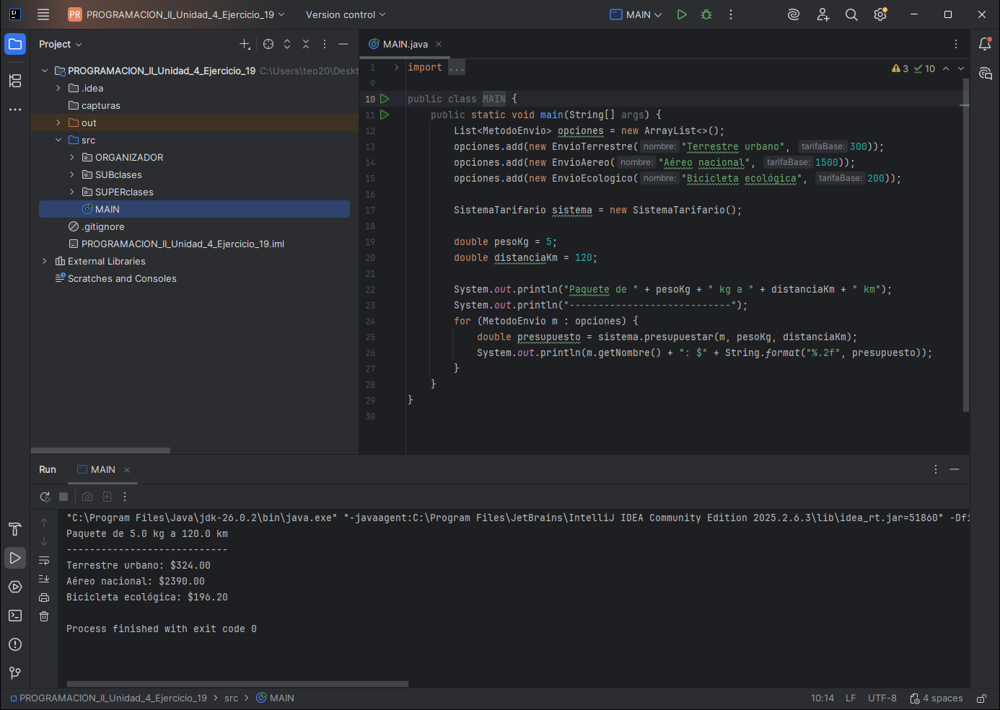

# PROGRAMACIÓN II — Unidad 4, Ejercicio 19: Cálculo de Costos de Encomiendas por Empresa Logística

Trabajo práctico de Programación II. Este repositorio contiene la resolución en Java del ejercicio 19 de la Unidad 4.

## Consigna

#### Contexto

Una red de transporte de encomiendas calcula las tarifas de envío delegando la operación en diferentes sucursales o medios de entrega (transporte terrestre urbano, envío aéreo nacional y distribución en bicicleta ecológica). Cada medio calcula el costo final ponderando variables de peso y distancia de manera polimórfica.

#### Consigna

Diseñar un sistema modular en Java donde el cálculo del costo de despacho postal se resuelva mediante polimorfismo aplicando las reglas tarifarias de cada medio de entrega.

#### Desarrollo requerido

- Crear una clase abstracta MetodoEnvio con atributos de tarifas base y el método abstracto double calcularTarifa(double pesoKg, double distanciaKm).
- Desarrollar clases hijas como EnvioTerrestre, EnvioAereo y EnvioEcologico que sobrescriban el método con factores multiplicadores propios por tipo de tracción.
- Crear una clase SistemaTarifario que reciba cualquier tipo de método de envío y devuelva el presupuesto estimado al usuario.
- En el método main, instanciar distintas opciones de despacho, evaluar el costo de un mismo paquete de forma polimórfica y mostrar los resultados comparativos por consola.

## Estructura del repositorio

```
PROGRAMACION_II_Unidad_4_Ejercicio_19/
├── README.md
├── capturas/
│   └── consola.png
└── src/
    ├── ORGANIZADOR/
    │   └── SistemaTarifario.java
    ├── SUBclases/
    │   ├── EnvioAereo.java
    │   ├── EnvioEcologico.java
    │   └── EnvioTerrestre.java
    ├── SUPERclases/
    │   └── MetodoEnvio.java
    └── MAIN.java   # clase con el método main
```

## Funcionamiento y lógica

El ejercicio aplica **polimorfismo** para presupuestar un envío con distintos métodos de entrega. Está organizado en los paquetes `SUPERclases`, `SUBclases` y `ORGANIZADOR`.

### `SUPERclases.MetodoEnvio` (clase abstracta)

Tiene `nombre` y `tarifaBase` (privados, con getters) y el método abstracto `calcularTarifa(pesoKg, distanciaKm)`.

### `SUBclases`

- **`EnvioTerrestre`:** tarifa base + peso × distancia × 0.04.
- **`EnvioAereo`:** tarifa base + peso × distancia × 0.15 + un recargo fijo de $800.
- **`EnvioEcologico`:** tarifa base + peso × distancia × 0.03, con un **10 % de descuento** sobre el total.

### `ORGANIZADOR.SistemaTarifario`

Su método `presupuestar(metodo, peso, distancia)` le pide la tarifa a cualquier método de envío.

### `MAIN`

Presupuesta un paquete de **5 kg** a **120 km** con los tres métodos (peso × distancia = 600):

| Método | Cálculo | Presupuesto |
|---|---|---|
| Terrestre urbano | 300 + 24 | **$324.00** |
| Aéreo nacional | 1500 + 90 + 800 | **$2390.00** |
| Bicicleta ecológica | (200 + 18) − 10 % | **$196.20** |

## Ejecución

Captura de la consola de IntelliJ IDEA ejecutando el programa:



Salida obtenida:

```
Paquete de 5.0 kg a 120.0 km
----------------------------
Terrestre urbano: $324.00
Aéreo nacional: $2390.00
Bicicleta ecológica: $196.20
```
